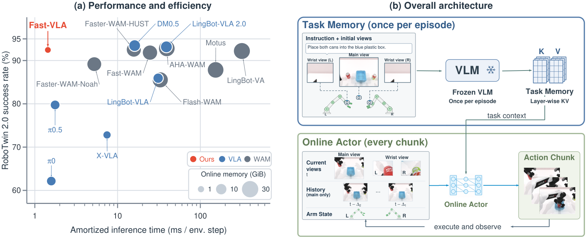

# Fast-VLA: You Only Think Once for Robot Manipulation

<p align="center">
  <a href="https://arxiv.org/abs/2610.21389"></a>
  <a href="https://garfield-kh.github.io/FastVLA"></a>
  <a href="https://huggingface.co/kehong/FastVLA-weights"></a>
</p>

<p align="center"></p>

**Fast-VLA** (FastVLA) calls its 4B vision-language model **once per episode**. The frozen VLM
reads the instruction and the initial camera views, and its layer-wise key/value cache is kept as
a fixed *task memory*. At every action chunk only a lightweight online actor runs: it reads the
current views and robot state, queries the task memory, and predicts the next chunk of actions.

| Benchmark | Success rate (%) | Amortized inference | Online resident memory |
|---|:---:|:---:|:---:|
| RoboTwin 2.0 (Clean / Randomized) | 92.46 / 92.40 | 1.437 ms / step | 1.22 GiB |
| LIBERO / LIBERO-Plus | 95.95 / 79.11 | 3.975 ms / step | 0.86 GiB |

On RoboTwin 2.0 this is 10.9–17.1× less inference time per step than Faster-WAM (HUST), DM0.5
and Fast-WAM on the same hardware. Full comparisons are on the [project page](https://garfield-kh.github.io/FastVLA).

This repository contains:

- the Fast-VLA model, its training code and the first-frame cache ("bank") builder
- a policy server and evaluation clients for **RoboTwin 2.0**, **LIBERO** and **LIBERO-Plus**
- the two released checkpoints, `fastvla-robotwin` and `fastvla-libero`

## 📰 News

- **2026/10** — Paper on [arXiv](https://arxiv.org/abs/2610.21389); code and checkpoints released.

## 🛠️ Installation

```bash
conda create -n fastvla python=3.11 -y && conda activate fastvla
pip install torch==2.11.0 torchvision==0.26.0 --index-url https://download.pytorch.org/whl/cu128
git clone https://github.com/dexmal/opendm.git && cd opendm && git checkout e41e501 && pip install -e . && cd ..
pip install -r requirements.txt
```

The simulators (RoboTwin 2.0, LIBERO) run in their own environments and talk to the policy
server over a local socket. See [docs/INSTALL.md](docs/INSTALL.md) for details, including
**Ascend NPU** support.

## 🤗 Checkpoints

| Model | Trained on | Size |
|---|---|---|
| [`fastvla-robotwin`](https://huggingface.co/kehong/FastVLA-weights/tree/main/fastvla-robotwin) | RoboTwin 2.0, 27,500 demos (50 clean + 500 randomized per task) | 272M |
| [`fastvla-libero`](https://huggingface.co/kehong/FastVLA-weights/tree/main/fastvla-libero) | LIBERO Spatial / Object / Goal / Long, 2,000 demos | 185M |

```bash
hf download kehong/FastVLA-weights --local-dir checkpoints   # or only one: --include "fastvla-libero/*"
```

The frozen DM0.5 VLM is downloaded from the Hugging Face Hub on first use.

## 🚀 Quick Start

```python
from fastvla.policy import FastVLAPolicy

policy = FastVLAPolicy("checkpoints/fastvla-robotwin")   # online actor + frozen DM0.5
policy.reset()                                           # start of an episode
views = [head_rgb, left_wrist_rgb, right_wrist_rgb]      # uint8 H x W x 3 frames
state = joint_targets                                    # 14 values, both arms
actions = policy.act(views, state, "Place the cans in the plastic box.")   # (50, 14)
```

The first `act()` of an episode builds the task memory; later calls only run the actor.

## 📊 Evaluation

Start a policy server:

```bash
python scripts/serve.py --model checkpoints/fastvla-robotwin --port 8765
```

**RoboTwin 2.0** — copy the plug-in into RoboTwin and run the official harness (100 episodes per task):

```bash
cp -r benchmarks/robotwin/FastVLA <RoboTwin>/policy/
cd <RoboTwin>
FASTVLA_ROOT=/path/to/FastVLA bash policy/FastVLA/eval.sh beat_block_hammer demo_clean 8765 0
```

**LIBERO / LIBERO-Plus** — serve `checkpoints/fastvla-libero`, then in the simulator environment:

```bash
python scripts/eval_libero.py --benchmark libero --port 8765 --out results/libero
python scripts/eval_libero.py --benchmark libero_plus --port 8765 --out results/plus --shard 0 --nshard 4
```

Reported scores average the 50 tasks in `assets/robotwin_tasks.txt` (Clean and Randomized
separately), the four LIBERO suites, and the 10,030 LIBERO-Plus variants in
`assets/libero_plus_manifest.json`.

## 🏋️ Training

Index the demonstrations, precompute the frozen VLM's first-frame cache for every training
episode, then train the actor. See [docs/TRAINING.md](docs/TRAINING.md).

## ✅ Checking an installation

`tests/reference_actions.npz` holds a few real observations and the actions the released models
produce for them:

```bash
python tests/test_reference.py --robotwin checkpoints/fastvla-robotwin --libero checkpoints/fastvla-libero
```

## Citation

```bibtex
@article{gong2026fastvla,
  title   = {Fast-VLA: You Only Think Once for Robot Manipulation},
  author  = {Gong, Kehong and Hou, Guanli and Zheng, Xiaoxu and Wang, Qi and Xu, Mingxi and
             Zhai, Anbang and He, Xiaoyu and Zhang, Mingyuan and Mi, Michael Bi},
  journal = {arXiv preprint arXiv:2610.21389},
  year    = {2026}
}
```

## Acknowledgements

Fast-VLA builds on [DM0.5](https://www.dexmal.com/blog/dm0.5/index_en.html) and
[OpenDM](https://github.com/dexmal/opendm), [DINOv2](https://github.com/facebookresearch/dinov2),
and the [RoboTwin 2.0](https://github.com/RoboTwin-Platform/RoboTwin),
[LIBERO](https://github.com/Lifelong-Robot-Learning/LIBERO) and
[LIBERO-Plus](https://github.com/sylvestf/LIBERO-plus) benchmarks. We thank their authors for
releasing their code, models and data.

## License

Code: Apache-2.0. DM0.5 (used frozen, downloaded from the Hugging Face Hub) is distributed under
the Gemma license.
